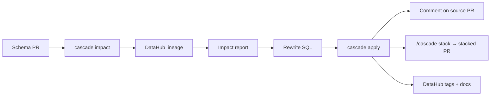
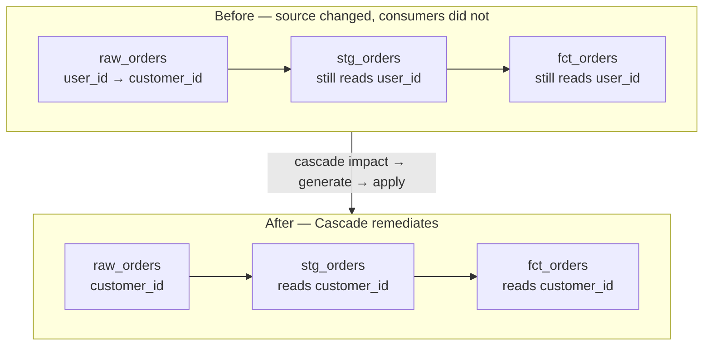
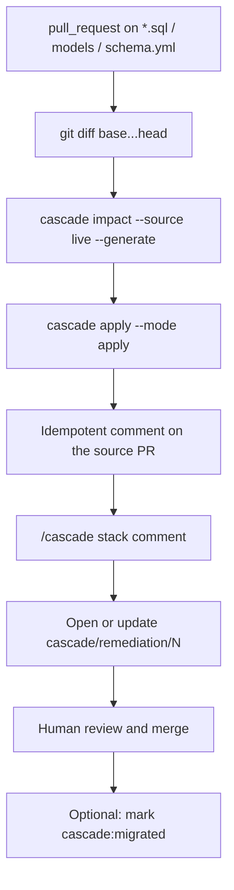

# Cascade

**A breaking schema PR becomes a coordinated migration.** Cascade reads [DataHub](https://datahubproject.io/) lineage, comments on the schema PR with everything downstream it breaks, and, when you ask, opens a stacked pull request with the downstream SQL rewritten.

It does not connect to your warehouse. It does not merge without a human. It coordinates the work that usually lives in Slack threads and stale tickets.

```text
pip install cascade-bot
cascade setup
```

Or let your AI agent do it: copy the **Install with an AI agent** prompt from the website, or point Claude Code, Cursor, or Codex at [`frontend/public/install.md`](frontend/public/install.md).

Python 3.11+ · Apache-2.0 · GitHub Actions · DataHub Cloud or self-hosted GMS · SQL / dbt

---

## Why

Renaming `user_id` to `customer_id` on a raw table is a one-line PR. The blast radius is not. Downstream models, marts, and ML features still read the old name. Owners are scattered. The catalog is out of date the moment the source lands.

Cascade turns that into a repeatable loop: **impact → rewrite → reviewable PR → catalog write-back.**

## How it works




1. A pull request changes SQL, dbt models, or `schema.yml`.
2. Cascade maps the changed paths to DataHub URNs (`.cascade/config.json`).
3. It walks downstream lineage, owners, and ML features.
4. In LLM mode, it rewrites affected SQL and dbt files.
5. It comments on the source PR (clear, or a summary with `/cascade stack`).
6. On `/cascade stack`, it opens `cascade/remediation/<pr>` on top of this PR's commits.
7. On merge, it can mark the source `cascade:migrated` in DataHub.

Dry-run is the default. Live GitHub and DataHub writes need explicit flags and secrets.

### Example: `user_id` → `customer_id`

A source PR renames a column on `raw_orders`. Downstream models still project `user_id`. Cascade walks lineage, comments the blast radius, and opens a stacked PR when you comment `/cascade stack`.




The same loop is what the GitHub Action runs on every breaking SQL PR.

## What Cascade is and is not


| It is                                                        | It is not                                                   |
| ------------------------------------------------------------ | ----------------------------------------------------------- |
| A CLI + GitHub Action that uses **existing** DataHub lineage | A warehouse connector, ingest pipeline, or migration runner |
| A rewriter of **SQL / dbt files in git**                     | A Looker / Tableau / Spark / ORM fixer                      |
| Fail-closed on live GMS (`--source live`)                    | A hosted SaaS, or a replacement for the DataHub UI          |
| Dry-run by default; humans merge                             | An autonomous merge bot                                     |


Warehouses (Snowflake, Postgres, BigQuery, …) work insofar as DataHub already has schema + lineage for those tables. The URN’s `dataPlatform` is a string; Cascade never takes a database password.

## Install

There are three ways to install Cascade in a repo. All of them end with a `.github/workflows/cascade.yml` on your default branch.

| Path | What you do | What it does for you |
| ---- | ----------- | -------------------- |
| **AI agent** | Paste the prompt from the website's **Install with an AI agent** button (source: [`frontend/public/install.md`](frontend/public/install.md)) into Claude Code, Cursor, Codex, or any agent that can run commands | Runs setup on a branch, asks you to map tables it can't match, has you run `gh secret set` yourself so keys never reach the chat, runs `cascade doctor`, opens a PR |
| **CLI** | `pip install cascade-bot` then `cascade setup` | Writes the config, `.env.example`, and workflow, maps SQL files to DataHub URNs, optionally sets Actions secrets |
| **GitHub App** | Sign in on the website and install the Cascade App | Commits the workflow, or opens a `cascade/setup` PR on protected branches. You still add secrets and `.cascade/config.json` |

The agent prompt tells the user the parts people get surprised by: the files have to be committed and merged, `/cascade stack` only works once the workflow is on the default branch, and the repo has to allow Actions to open pull requests.

```bash
pip install cascade-bot
cascade setup
```

From a clone of this repo (development):

```bash
pip install -e .
```

Optional extras: `[writeback]` (DataHub ingest SDK), `[ui]` (local playground API).

Pin a git tag or commit in CI. Do not float `main` in production workflows.

## Quick start (offline)

No DataHub, no GitHub token. Uses the bundled fixture catalog.

```bash
pip install -e .
cascade demo --out artifacts/demo
```

Inspect:


| Artifact                                      | What it is                               |
| --------------------------------------------- | ---------------------------------------- |
| `artifacts/demo/apply/pr_comment.md`          | Blast radius + rationale                 |
| `artifacts/demo/apply/downstream_pr.diff`     | Rewritten SQL patch                      |
| `artifacts/demo/apply/datahub_writeback.json` | Planned catalog write-back (not applied) |


Stepwise, same fixture:

```bash
cascade impact \
  --urn 'urn:li:dataset:(urn:li:dataPlatform:snowflake,analytics.raw_orders,PROD)' \
  --diff examples/diffs/raw_orders_rename_user_id.json \
  --generate --models-dir examples/models --out /tmp/cascade-out

cascade apply --report /tmp/cascade-out/impact_report.json --out /tmp/cascade-apply
```

`--diff` is a JSON changes file or a unified diff (`.patch` / `.sql.diff`). JSON is detected by a leading `{` or `[`; everything else is parsed as a diff.

Tests: `python -m unittest discover -s tests -v`

## Use it on your repo

You need:

1. A GitHub repo with SQL / dbt (`*.sql`, `models/`, `schema.yml`).
2. Those tables already in DataHub with schema and **downstream lineage**.
3. Python 3.11+ in CI.

Then:

```bash
pip install cascade-bot
cascade setup
```

`setup` writes `.cascade/config.json`, `.env.example`, and `.github/workflows/cascade.yml`, probes DataHub if `DATAHUB_GMS_URL` is set, and tries to map SQL paths to catalog URNs. Pass `--demo` to skip live GMS (local/fixture path). `--non-interactive` fails instead of prompting. `--skip-secrets` skips GitHub Actions secrets.

The workflow `setup` writes is a small caller of Cascade's reusable workflow ([`run.yml`](.github/workflows/run.yml)), pinned to the release tag. Installing the Cascade GitHub App commits the same file but does **not** write `.cascade/config.json`; run `cascade setup` (or the agent prompt) for that. Add `DATAHUB_GMS_URL` (and `DATAHUB_TOKEN` if needed) as Actions secrets. For rewrites, add the secret `LLM_API_KEY` and the variables `CASCADE_MODE=llm` and `LLM_MODEL`. Keys stay in your repository secrets.

`cascade init` only writes the same files. `cascade doctor` is the check `setup` runs at the end.

Copy `.env.example` → `.env` if you want a local file (never commit `.env`; `setup` adds it to `.gitignore`). Commit the other files and merge them into the default branch. Live PR comments still need DataHub.

### Map paths to URNs

```json
{
  "models_dir": "models",
  "default_urn": "urn:li:dataset:(urn:li:dataPlatform:postgres,shop.public.raw_orders,PROD)",
  "mappings": [
    {
      "path": "models/",
      "urn": "urn:li:dataset:(urn:li:dataPlatform:postgres,shop.public.raw_orders,PROD)"
    }
  ],
  "urn_files": {},
  "rewrite": {
    "mode": "off",
    "provider": "openai",
    "model": ""
  }
}
```

Longest matching path prefix wins. Override with `--urn` or `CASCADE_SOURCE_URN`. Nested files can be pinned in `urn_files`.

Copy-paste Action: [`examples/github-action/`](examples/github-action/).

### GitHub Action

On a pull request that touches SQL / models / schema:




Required secret: `DATAHUB_GMS_URL` (HTTPS — Actions cannot see `localhost`). Optional secrets: `DATAHUB_TOKEN`, `LLM_API_KEY`, `CASCADE_WRITEBACK`. Variables: `CASCADE_MODE`, `LLM_MODEL`, and for non-OpenAI providers `CASCADE_LLM_PROVIDER` and `LLM_BASE_URL`.

Before you rely on it:

- `/cascade stack` runs on `issue_comment`, which GitHub only runs from the **default branch**. Merge the workflow first.
- Stacked PRs are opened with `GITHUB_TOKEN`, so enable **Settings → Actions → General → Allow GitHub Actions to create and approve pull requests**.
- If your org restricts actions, allow `himxsh/Cascade` (the caller uses its reusable workflow).
- The job has `contents: write` and `pull-requests: write`. It comments, and pushes `cascade/remediation/*` only after `/cascade stack`. It never merges.

This repo’s own workflows also keep an offline **fixture-ci** job. Consumer templates do not: they fail if GMS is missing.

On merge of `cascade/remediation/*`, [`.github/workflows/cascade-migrated.yml`](.github/workflows/cascade-migrated.yml) can call `mark_migrated`.

## CLI


| Command                                 | Purpose                                                     |
| --------------------------------------- | ----------------------------------------------------------- |
| `cascade setup`                         | First-time setup: files, DataHub probe, optional `gh` secrets |
| `cascade init`                          | Write config, `.env.example`, and the Action template only  |
| `cascade doctor`                        | Check Python, config, URN mapping, GMS health, rewrite mode |
| `cascade demo`                          | Fixture path: impact → generate → apply dry-run             |
| `cascade impact --diff …`               | Blast-radius `ImpactReport` (JSON on stdout)                |
| `cascade impact … --generate --out DIR` | Impact + rewritten SQL                                      |
| `cascade generate --report … --out DIR` | Remediations from an existing report                        |
| `cascade apply --report … --out DIR`    | Artifacts; live GitHub/DataHub only with `--mode apply`     |
| `cascade policy --report …`             | High severity + `/cascade stack` requires an open stacked PR |


`--source`:


| Value                   | Behavior                                            |
| ----------------------- | --------------------------------------------------- |
| `fixture` (CLI default) | Bundled demo graph — offline                        |
| `live`                  | DataHub GMS (`DATAHUB_GMS_URL`); fails if unhealthy |
| `auto`                  | Live first, fixture fallback with a stderr notice   |


Live mode hydrates datasets, lineage, and owners from GMS GraphQL. Consumer CI should use `live`, not `auto`.

## Rewrite modes

`CASCADE_MODE=off` (default) produces a report only. Set `CASCADE_MODE=llm` to enable rewrites. Env wins over `.cascade/config.json`.


| Mode            | Behavior                                                                                                                                                                                                                                       |
| --------------- | ---------------------------------------------------------------------------------------------------------------------------------------------------------------------------------------------------------------------------------------------- |
| `off`           | Report only. No remediations are produced.                                                                                                                                                                                                                |
| `llm`           | One call edits all affected SQL models, macros, and `schema.yml` files. Requires `LLM_API_KEY` (or `OPENAI_API_KEY`) and `LLM_MODEL`. There is no fallback; on failure Cascade posts the report only. Tested with Claude Sonnet 5.5 at medium effort. |


Providers (`CASCADE_LLM_PROVIDER`): `openai` (default), `anthropic`, `azure-openai`, `bedrock`, `ollama`, `custom`. `anthropic`, `azure-openai`, `bedrock`, and `custom` require `LLM_BASE_URL`. `ollama` defaults to `localhost`, which Actions runners cannot reach.

A key in the environment does **not** turn LLM on. Mode must be `llm`.

## Environment


| Variable                                                   | When                                         |
| ---------------------------------------------------------- | -------------------------------------------- |
| `DATAHUB_GMS_URL` / `DATAHUB_TOKEN`                        | `--source live` and live write-back          |
| `CASCADE_SOURCE_URN`                                       | URN when path mapping misses                 |
| `CASCADE_MODE`                                             | `off` (default) or `llm`                     |
| `CASCADE_LLM_PROVIDER` / `LLM_MODEL` / `LLM_BASE_URL`      | LLM path                                     |
| `LLM_API_KEY` or `OPENAI_API_KEY`                          | LLM path                                     |
| `CASCADE_WRITEBACK=1`                                      | Live DataHub/ML tags (never on untrusted CI) |
| `GITHUB_TOKEN` / `GITHUB_REPOSITORY` / `CASCADE_PR_NUMBER` | Live PR comment (Action sets these)          |
| `CASCADE_OPEN_DOWNSTREAM_PR=1`                             | Open stacked PR (`/cascade stack` sets this) |
| `DATABASE_URL` / `SESSION_SECRET` / `GITHUB_OAUTH_*`       | Hosted dashboard only (not the CLI)          |
| `CASCADE_DEV_LOGIN=1`                                      | Local dashboard test login (never production)|
| `GITHUB_APP_ID` / `GITHUB_APP_SLUG` / `GITHUB_WEBHOOK_SECRET` | GitHub App (when registered)              |

The GitHub App installation flow adds a caller workflow to the default branch (or opens a setup PR when direct pushes are blocked). Store `LLM_API_KEY` and `DATAHUB_GMS_URL` in Actions secrets and configure `CASCADE_MODE` and `LLM_MODEL` as repository variables; Cascade never receives the key.


See `.env.example`. Actions secrets override `.env`. There are no warehouse credentials in this contract.

## Production behavior


| Concern        | Behavior                                                                                                                   |
| -------------- | -------------------------------------------------------------------------------------------------------------------------- |
| Modes          | `apply --mode dry-run` (default) writes artifacts only; `--mode apply` allows live GitHub/DataHub when secrets are set     |
| Policy         | `severity=high` + `/cascade stack` requires an open stacked PR (`--require-policy`)                                        |
| Comments       | Re-runs **edit** the existing `## Cascade impact report` comment (clear, or summary + stack option)                        |
| Stacked PR     | Opt-in via `/cascade stack`. Same upstream PR → `cascade/remediation/{n}` on top of the source commits                     |
| Audit          | Receipts under `.cascade/runs/<id>/` (gitignored)                                                                           |
| Failures       | No GMS on consumer CI → fail; no `CASCADE_OPEN_DOWNSTREAM_PR` → patch artifacts only; LLM failure → report only |


Dialect-specific quoting (BigQuery backticks, Snowflake `QUALIFY`, mixed-case Postgres identifiers) is not modeled yet. Plain `user_id` → `customer_id` in vanilla dbt SQL is the supported case.

## Optional local UI

Marketing site plus a GitHub sign-in dashboard for enabling repos:

```bash
pip install -e ".[ui]"
cp .env.example .env
# Local harness so the dashboard works without a GitHub OAuth App:
#   CASCADE_DEV_LOGIN=1
#   SESSION_SECRET=dev-insecure
#   DATABASE_URL=sqlite:///./cascade.db
uvicorn api.server:app --reload --port 8000
# in another terminal:
cd frontend && npm install && npm run dev
```

[http://localhost:5173](http://localhost:5173) — marketing at `/`, then **Sign in** → `/app`. `POST /api/run` and `GET /api/health` still work. Webhooks: `POST /api/github/webhook` (HMAC). App comments are not live until GitHub App secrets exist; see Docs → GitHub App.

## Limitations

- No lineage in DataHub means no blast radius. Cascade will not invent the graph.
- When DataHub has column-level lineage, blast radius is the datasets that consume the changed columns. Missing column lineage falls back to table-level — never “no impact.”
- Downstream in another GitHub repository is out of scope.
- Non-SQL consumers are out of scope.

## Contributing

See [CONTRIBUTING.md](CONTRIBUTING.md). Issues and pull requests are welcome.

```bash
pip install -e ".[dev]"
python -m unittest discover -s tests -v
```

To release, bump `__version__` in `cascade/__init__.py` (the only place the version lives) and merge to `main`. [`publish.yml`](.github/workflows/publish.yml) uploads any version PyPI does not have yet. CI fails a PR that changes `cascade/` without a bump; add the `no-release` label to skip that.

## License

Apache License 2.0. See [LICENSE](LICENSE). Copyright 2026 Cascade contributors.
