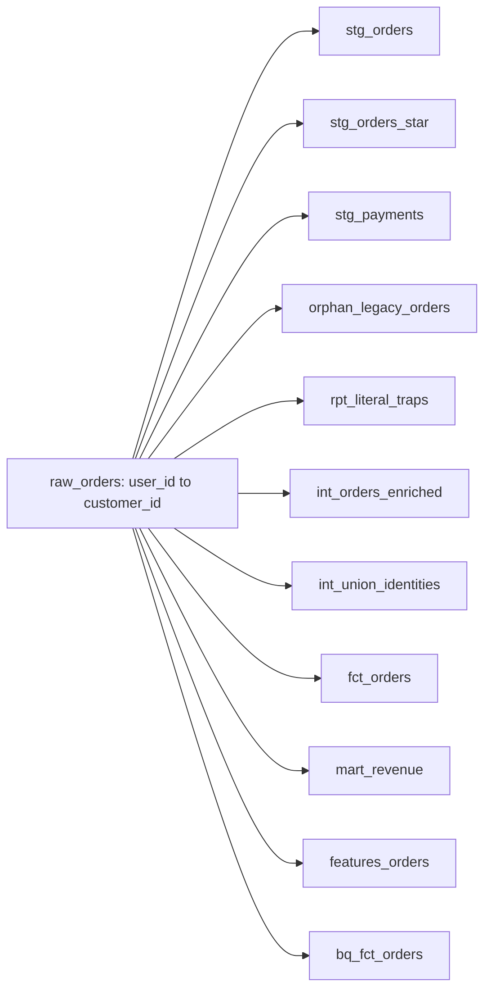
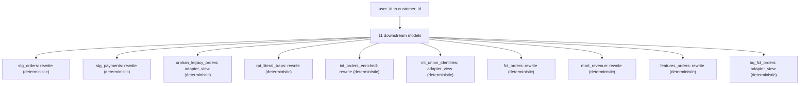

# Fix 11 downstream models after user_id → customer_id

A breaking schema change on **raw_orders** (user_id to customer_id) would break **11** downstream models.
This PR applies Cascade's rewrite so those models keep working.

- **Severity:** high
- **Agent:** deterministic

## What could break

## How Cascade fixed it

## Files in this PR

- `examples/mean/stg_orders.sql` — rewrite (deterministic) — downstream SQL stg_orders.sql references user_id in SELECT/JOIN; rewriting to customer_id to match upstream schema change
- `examples/mean/stg_payments.sql` — rewrite (deterministic) — downstream SQL stg_payments.sql references user_id in SELECT/JOIN; rewriting to customer_id to match upstream schema change
- `examples/mean/rpt_literal_traps.sql` — rewrite (deterministic) — downstream SQL rpt_literal_traps.sql references user_id in SELECT/JOIN; rewriting to customer_id to match upstream schema change
- `examples/mean/int_orders_enriched.sql` — rewrite (deterministic) — downstream SQL int_orders_enriched.sql references user_id in SELECT/JOIN; rewriting to customer_id to match upstream schema change
- `examples/mean/fct_orders.sql` — rewrite (deterministic) — downstream SQL fct_orders.sql references user_id in SELECT/JOIN; rewriting to customer_id to match upstream schema change
- `examples/mean/mart_revenue.sql` — rewrite (deterministic) — downstream SQL mart_revenue.sql references user_id in SELECT/JOIN; rewriting to customer_id to match upstream schema change
- `examples/mean/features_orders.sql` — rewrite (deterministic) — downstream SQL features_orders.sql references user_id in SELECT/JOIN; rewriting to customer_id to match upstream schema change

## Other actions

- **adapter_view** `orphan_legacy_orders` — no SQL model found for downstream node; recommend adapter view to alias user_id->customer_id while downstream migrates
- **adapter_view** `int_union_identities` — rewrite of user_id->customer_id in int_union_identities.sql failed schema gate; falling back to adapter view
- **adapter_view** `bq_fct_orders` — rewrite of user_id->customer_id in bq_fct_orders.sql failed schema gate; falling back to adapter view

Details (URNs, owners, ML)

**Source:** `urn:li:dataset:(urn:li:dataPlatform:snowflake,analytics.raw_orders,PROD)`

- `urn:li:dataset:(urn:li:dataPlatform:snowflake,analytics.stg_orders,PROD)` — owners: urn:li:corpuser:alice
- `urn:li:dataset:(urn:li:dataPlatform:snowflake,analytics.stg_orders_star,PROD)` — owners: urn:li:corpuser:alice
- `urn:li:dataset:(urn:li:dataPlatform:snowflake,analytics.stg_payments,PROD)` — owners: urn:li:corpuser:alice
- `urn:li:dataset:(urn:li:dataPlatform:snowflake,analytics.orphan_legacy_orders,PROD)` — owners: urn:li:corpuser:alice
- `urn:li:dataset:(urn:li:dataPlatform:snowflake,analytics.rpt_literal_traps,PROD)` — owners: urn:li:corpuser:eve
- `urn:li:dataset:(urn:li:dataPlatform:snowflake,analytics.int_orders_enriched,PROD)` — owners: urn:li:corpuser:bob
- `urn:li:dataset:(urn:li:dataPlatform:snowflake,analytics.int_union_identities,PROD)` — owners: urn:li:corpuser:eve
- `urn:li:dataset:(urn:li:dataPlatform:snowflake,analytics.fct_orders,PROD)` — owners: urn:li:corpuser:bob
- `urn:li:dataset:(urn:li:dataPlatform:snowflake,analytics.mart_revenue,PROD)` — owners: urn:li:corpuser:bob, urn:li:corpuser:carol
- `urn:li:dataset:(urn:li:dataPlatform:snowflake,analytics.features_orders,PROD)` — owners: urn:li:corpuser:ml-platform
- `urn:li:dataset:(urn:li:dataPlatform:snowflake,analytics.bq_fct_orders,PROD)` — owners: urn:li:corpuser:bob
- ML `urn:li:mlModel:(urn:li:dataPlatform:snowflake,churn_predictor,PROD)` via `user_id` → `retrain-suggested`

<!-- cascade:source_urn=urn:li:dataset:(urn:li:dataPlatform:snowflake,analytics.raw_orders,PROD) -->

## Suggested reviewers

- @alice
- @eve
- @bob
- @carol
- @ml-platform
