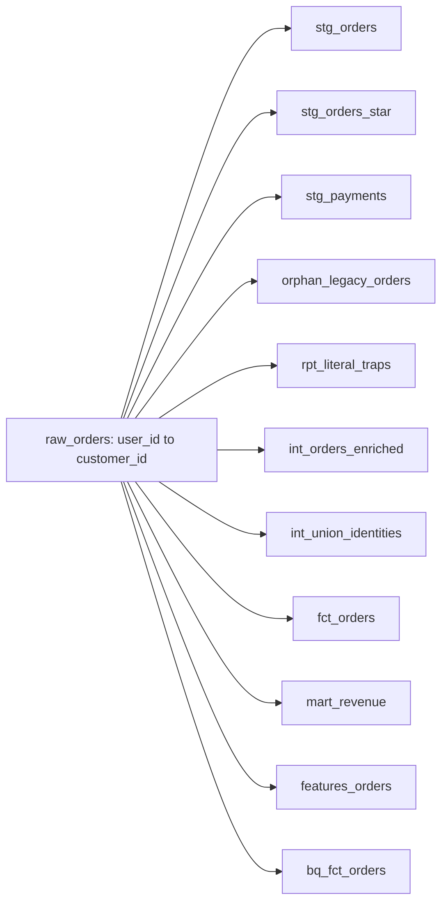

## Cascade impact report

**What changed:** user_id to customer_id on `raw_orders`
**Downstream:** 11 models (high)
**Agent:** deterministic

Cascade opened (or will open) a remediation PR with the SQL fix.

**ML:** retrain suggested for `churn_predictor`

**Source:** `urn:li:dataset:(urn:li:dataPlatform:snowflake,analytics.raw_orders,PROD)`
