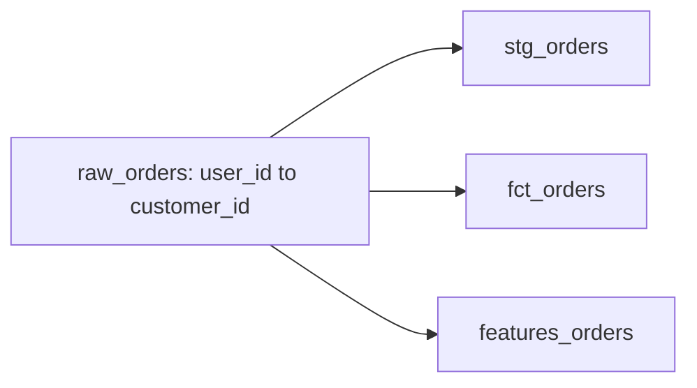

# Fix 3 downstream models after user_id → customer_id

A breaking schema change on **raw_orders** (user_id to customer_id) would break **3** downstream models.
This PR applies Cascade's rewrite so those models keep working.

- **Severity:** high
- **Agent:** deterministic

## What could break

## How Cascade fixed it

_No remediations generated._

## Files in this PR

_No SQL files rewritten (adapter/deprecate only)._

Details (URNs, owners, ML)

**Source:** `urn:li:dataset:(urn:li:dataPlatform:snowflake,analytics.raw_orders,PROD)`

- `urn:li:dataset:(urn:li:dataPlatform:snowflake,analytics.stg_orders,PROD)` — owners: urn:li:corpuser:alice
- `urn:li:dataset:(urn:li:dataPlatform:snowflake,analytics.fct_orders,PROD)` — owners: urn:li:corpuser:alice
- `urn:li:dataset:(urn:li:dataPlatform:snowflake,analytics.features_orders,PROD)` — owners: urn:li:corpuser:bob
- ML `urn:li:mlModel:(urn:li:dataPlatform:snowflake,churn_predictor,PROD)` via `user_id` → `retrain-suggested`

<!-- cascade:source_urn=urn:li:dataset:(urn:li:dataPlatform:snowflake,analytics.raw_orders,PROD) -->
